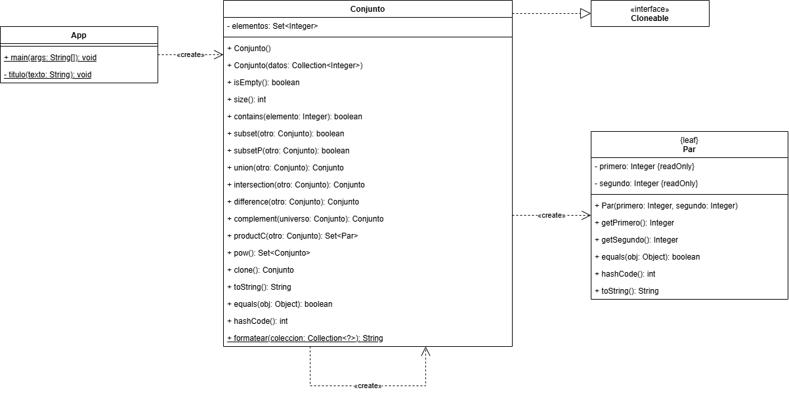

# Conjuntos

Implementación en Java de un tipo de dato abstracto Conjunto, desarrollada para la materia de Tecnologías de Programación. La clase `Conjunto` ofrece las operaciones de la teoría de conjuntos que pide el enunciado: pertenencia, subconjunto, subconjunto propio, unión, intersección, diferencia, complemento, producto cartesiano y conjunto potencia. También implementa clonación, igualdad y representación en texto.

Esta es la primera versión del proyecto y, como se acordó con la profesora, trabaja únicamente con elementos de tipo `Integer`. Los ejemplos del enunciado usan días de la semana; en el programa de prueba se representan con números (lunes = 1, martes = 2, …, domingo = 7). La segunda versión generalizará el conjunto a cualquier tipo de dato mediante genéricos.

## Ejecución

Se requiere Java 9 o superior, porque el programa de prueba usa `List.of`. El proyecto no depende de ningún IDE ni de bibliotecas externas. Para compilarlo y ejecutarlo desde una terminal, en la raíz del proyecto:

```
javac -encoding UTF-8 -d bin src/*.java
java -cp bin App
```

También puede abrirse en cualquier IDE con soporte para Java (VS Code, IntelliJ IDEA, Eclipse, NetBeans): basta con marcar `src` como carpeta de código fuente y ejecutar la clase `App`.

Las operaciones se imprimen solo con caracteres del teclado, sin símbolos matemáticos. Algunos títulos llevan acentos, y en Windows la consola puede mostrarlos como caracteres extraños; se corrige ejecutando `chcp 65001` antes del programa.

## Operaciones

| # | Operación | Método | Ejemplo |
|---|---|---|---|
| 1 | Conjunto vacío | `isEmpty()` | `{}` → `true` |
| 2 | Pertenencia | `contains(elemento)` | `6` en `{2, 4, 6}` → `true` |
| 3 | Subconjunto | `subset(otro)` | `{2, 4, 6}` ⊆ `{2, 3, 4, 5, 6, 7}` → `true` |
| 4 | Subconjunto propio | `subsetP(otro)` | `{2, 4, 6}` ⊂ `{2, 4, 6}` → `false` |
| 5 | Unión | `union(otro)` | `{2, 4, 6}` ∪ `{1, 3, 4, 5, 7}` → `{2, 4, 6, 1, 3, 5, 7}` |
| 6 | Intersección | `intersection(otro)` | `{2, 4, 6}` ∩ `{1, 3, 4, 5, 7}` → `{4}` |
| 7 | Diferencia | `difference(otro)` | `{2, 4, 6}` − `{1, 3, 4, 5, 7}` → `{2, 6}` |
| 8 | Complemento | `complement(universo)` | complemento de `{1, 3, 4, 5, 7}` en la semana → `{2, 6}` |
| 9 | Clonación | `clone()` | copia independiente con los mismos elementos |
| 10 | Listar elementos | `toString()` | `{2, 4, 6}` |
| 11 | Igualdad | `equals(obj)` | `{2, 4, 6}` = `{6, 2, 4}` → `true` |
| 12 | Producto cartesiano | `productC(otro)` | `{1, 4, 14}` × `{1, 3}` → `{(1, 1), (1, 3), (4, 1), (4, 3), (14, 1), (14, 3)}` |
| 13 | Conjunto potencia | `pow()` | P(`{1, 2, 3}`) → 8 subconjuntos |

Las operaciones 5 a 9 devuelven un nuevo `Conjunto` y nunca modifican a los operandos, así que pueden encadenarse, por ejemplo `a.union(b).intersection(c)`.

## Decisiones de diseño

### Almacenamiento de los elementos

`Conjunto` guarda sus elementos en un `Set<Integer>` privado implementado con `LinkedHashSet`. Un `Set` garantiza por sí mismo que no haya elementos repetidos, que es la propiedad central de un conjunto. Se eligió `LinkedHashSet` en lugar de `HashSet` porque conserva el orden de inserción, y así la salida en consola es predecible y coincide con el orden en que se capturaron los datos. La búsqueda sigue siendo O(1).

El atributo es privado, de modo que si en el futuro se cambia la estructura (por ejemplo, a `TreeSet` para mostrar los elementos ordenados), el cambio queda contenido dentro de `Conjunto`.

### Responsabilidad de las operaciones

Todas las operaciones están en `Conjunto`, que es la clase que posee los elementos (Experto en información). Cada operación se apoya en el método equivalente de `Set`:

| Operación | Método de `Set` |
|---|---|
| Subconjunto | `containsAll` |
| Unión | `addAll` |
| Intersección | `retainAll` |
| Diferencia | `removeAll` |

Las operaciones que producen un conjunto primero clonan el operando izquierdo y aplican el cambio sobre la copia. Así el resultado es un `Conjunto` nuevo y los originales quedan intactos.

Las operaciones derivadas se expresan en términos de otras: el subconjunto propio es un subconjunto con menos elementos, y el complemento es la diferencia entre el universo y el conjunto. Esto evita repetir lógica.

### Complemento

El complemento solo tiene sentido respecto de un universo que contenga al conjunto. Por ello `complement(universo)` primero verifica que el conjunto sea subconjunto del universo y, si no lo es, lanza `IllegalArgumentException`. Devolver un resultado en ese caso ocultaría un error de uso.

### Producto cartesiano y la clase Par

El producto cartesiano produce pares ordenados, no números, así que su resultado no puede ser un `Conjunto` de `Integer`. Para representar cada par se creó la clase `Par`, un objeto de valor inmutable: la clase es `final`, sus atributos son `final` y no tiene métodos que los modifiquen. Implementa `equals()` y `hashCode()` para que dos pares con los mismos componentes se consideren el mismo elemento dentro de un `Set`. `productC` devuelve un `Set<Par>`.

### Conjunto potencia

El conjunto potencia es un conjunto de conjuntos, y por eso `pow()` devuelve un `Set<Conjunto>`. El algoritmo es iterativo: se parte del conjunto que solo contiene al vacío y, por cada elemento, se duplica la colección agregando ese elemento a una copia de cada subconjunto existente. Con n elementos se obtienen 2^n subconjuntos.

Los subconjuntos nuevos se acumulan en un conjunto temporal y se agregan al final de cada vuelta. Agregarlos directamente mientras se recorre la colección provocaría una `ConcurrentModificationException`.

Para que funcione, `Conjunto` sobrescribe `equals()` y `hashCode()` delegando en su `Set` interno. Sin eso, dos conjuntos con los mismos elementos se considerarían distintos.

### ¿Qué se requiere para que los resultados sean también tipo Conjunto?

El enunciado plantea esta pregunta. En esta versión, unión, intersección, diferencia, complemento y clonación sí devuelven `Conjunto`, porque sus resultados siguen siendo enteros. El producto cartesiano y el conjunto potencia no pueden hacerlo, porque sus elementos son pares y conjuntos, y un `Conjunto` solo admite `Integer`.

La respuesta es parametrizar la clase con genéricos, `Conjunto<T>`. Así `productC` podría devolver `Conjunto<Par<T, U>>` y `pow` un `Conjunto<Conjunto<T>>`, y todas las operaciones quedarían cerradas sobre el mismo tipo. Ese es el objetivo de la segunda versión.

### Clonación

`Conjunto` implementa `Cloneable` y sobrescribe `clone()` con tipo de retorno covariante (`Conjunto` en lugar de `Object`), lo que evita conversiones de tipo en quien lo usa. Después de `super.clone()` se crea un nuevo `LinkedHashSet` con los mismos elementos; sin ese paso, el original y la copia compartirían el mismo `Set` y modificar uno alteraría al otro.

No hace falta clonar cada elemento, porque `Integer` es inmutable: compartir la referencia a un entero es seguro, y la copia resulta independiente en la práctica. La `CloneNotSupportedException` no puede ocurrir, porque la clase implementa `Cloneable`; si ocurriera, se trataría de un error de programación, así que se relanza como `AssertionError`.

### Representación en texto

El `toString()` de las colecciones de Java usa corchetes (`[1, 2, 3]`), pero la notación de conjuntos usa llaves. El método estático `formatear(Collection<?>)` construye el texto con llaves y comas. Es estático y recibe cualquier colección para reutilizarlo con los resultados de `productC` y `pow`, que son `Set` y no `Conjunto`.

### Construcción a partir de una colección

El segundo constructor recibe cualquier `Collection<Integer>` (lista, conjunto, etc.), copia sus elementos y descarta los valores `null`, ya que un conjunto no debe contener elementos indefinidos. Los repetidos se eliminan solos al insertarse en el `Set`. Como se copian los elementos y no se guarda la referencia, modificar la colección original después no altera al conjunto.

### Estilo del código

Cada método tiene un solo `return`. Cuando el resultado depende de condiciones, como en `equals()`, se usa una variable que se asigna en cada caso y se devuelve al final.

## Clases

### App

Programa de prueba. Ejecuta las 13 operaciones con los ejemplos del enunciado y muestra cada resultado en consola, bajo un título por operación.

| Método | Acceso | Descripción |
|---|---|---|
| `main(String[] args)` | public static | Crea los conjuntos de ejemplo y prueba cada operación, incluido el caso de error del complemento |
| `titulo(String texto)` | private static | Imprime el encabezado de cada sección |

### Conjunto (implementa Cloneable)

Conjunto de enteros sin repetidos. Almacena sus elementos en un `LinkedHashSet` y concentra todas las operaciones de conjuntos.

| Método | Acceso | Descripción |
|---|---|---|
| `Conjunto()` | public | Crea un conjunto vacío |
| `Conjunto(Collection<Integer> datos)` | public | Crea un conjunto con los elementos de la colección, sin repetidos y descartando `null` |
| `isEmpty()` | public | Verdadero si el conjunto no tiene elementos |
| `size()` | public | Cantidad de elementos |
| `contains(Integer elemento)` | public | Determina si el elemento pertenece al conjunto |
| `subset(Conjunto otro)` | public | Verdadero si todos los elementos de este conjunto están en `otro` |
| `subsetP(Conjunto otro)` | public | Verdadero si es subconjunto de `otro` y tiene menos elementos |
| `union(Conjunto otro)` | public | Nuevo conjunto con los elementos de ambos |
| `intersection(Conjunto otro)` | public | Nuevo conjunto con los elementos comunes |
| `difference(Conjunto otro)` | public | Nuevo conjunto con los elementos de este que no están en `otro` |
| `complement(Conjunto universo)` | public | Elementos del universo que no están en este conjunto; lanza `IllegalArgumentException` si el conjunto no es subconjunto del universo |
| `productC(Conjunto otro)` | public | `Set<Par>` con todos los pares ordenados (a, b), con a en este conjunto y b en `otro` |
| `pow()` | public | `Set<Conjunto>` con todos los subconjuntos, incluidos el vacío y el propio conjunto |
| `clone()` | public | Copia independiente del conjunto |
| `toString()` | public | Elementos entre llaves, por ejemplo `{2, 4, 6}` |
| `equals(Object obj)` | public | Dos conjuntos son iguales si tienen los mismos elementos, sin importar el orden |
| `hashCode()` | public | Código hash consistente con `equals()` |
| `formatear(Collection<?> coleccion)` | public static | Texto de cualquier colección entre llaves; se usa para mostrar los resultados de `productC` y `pow` |

### Par (clase final)

Par ordenado de enteros, usado como elemento del producto cartesiano. Es inmutable.

| Método | Acceso | Descripción |
|---|---|---|
| `Par(Integer primero, Integer segundo)` | public | Crea el par con sus dos componentes |
| `getPrimero()` | public | Primer componente |
| `getSegundo()` | public | Segundo componente |
| `equals(Object obj)` | public | Dos pares son iguales si coinciden ambos componentes en el mismo orden |
| `hashCode()` | public | Código hash a partir de ambos componentes |
| `toString()` | public | Texto del par, por ejemplo `(4, 1)` |

## Ejemplo de ejecución

```
=== 5. Unión (union) ===
A = {2, 4, 6}   B = {1, 3, 4, 5, 7}
A union B = {2, 4, 6, 1, 3, 5, 7}

=== 8. Complemento (complement) ===
U = {1, 2, 3, 4, 5, 6, 7}   A = {1, 3, 4, 5, 7}
Complemento de A = {2, 6}
Complemento de {8, 9} -> error: El conjunto no es subconjunto del universo

=== 12. Producto cartesiano (productC) ===
A = {1, 4, 14}   B = {1, 3}
A x B = {(1, 1), (1, 3), (4, 1), (4, 3), (14, 1), (14, 3)}

=== 13. Conjunto potencia (pow) ===
A = {1, 2, 3}
P(A) = {{}, {1}, {2}, {1, 2}, {3}, {1, 3}, {2, 3}, {1, 2, 3}}
|P(A)| = 8
```

## Trabajo futuro

La segunda versión convertirá `Conjunto` en `Conjunto<T>` y `Par` en `Par<T, U>`, para admitir cualquier tipo de elemento: cadenas como los días de la semana del enunciado, objetos propios, etc. Con ese cambio, `productC` y `pow` también podrán devolver `Conjunto`, como se explica en la sección sobre la pregunta del enunciado.

Al generalizar, la clonación deberá revisarse. Con `Integer` basta copiar el `Set` porque los elementos son inmutables, pero con elementos mutables una copia profunda requeriría clonar también cada elemento.

## Diagrama de clases



El archivo editable se encuentra en `docs/`: [`Conjuntos.drawio`](docs/Conjuntos.drawio). Las flechas punteadas con la etiqueta `«create»` indican que una clase crea instancias de otra: `App` crea conjuntos, `Conjunto` crea pares en `productC()` y crea nuevos conjuntos en las operaciones que devuelven `Conjunto` y en `pow()`. La flecha con punta triangular hueca indica que `Conjunto` implementa la interfaz `Cloneable`. Los miembros subrayados son estáticos, `{readOnly}` marca los atributos `final` de `Par` y `{leaf}` indica que `Par` es una clase `final`.

## Autor

Sebastián Verdugo Bermúdez ([Sebastian1247](https://github.com/Sebastian1247))

Tecnologías de Programación, Maestría en Ciencias de la Computación, 1er semestre. [Tecnológico Nacional de México, Campus Culiacán](https://www.culiacan.tecnm.mx/posgrados/maestria-en-ciencias-de-la-computacion/)
